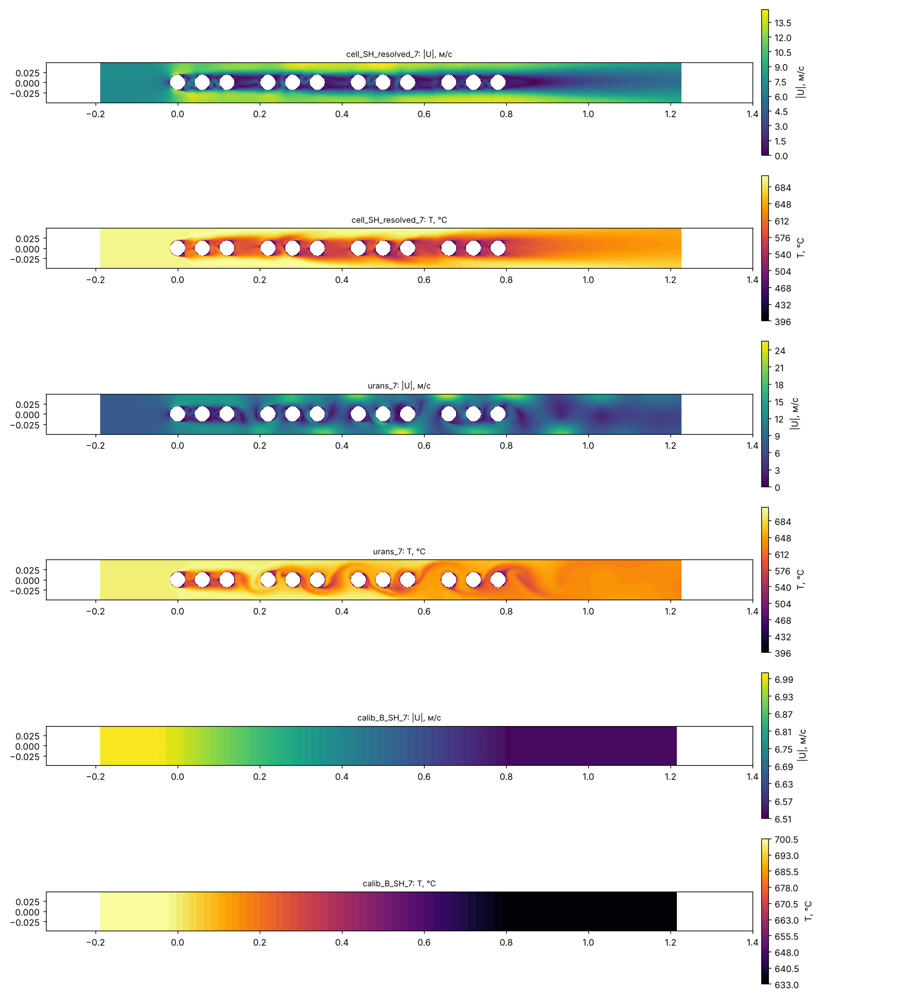
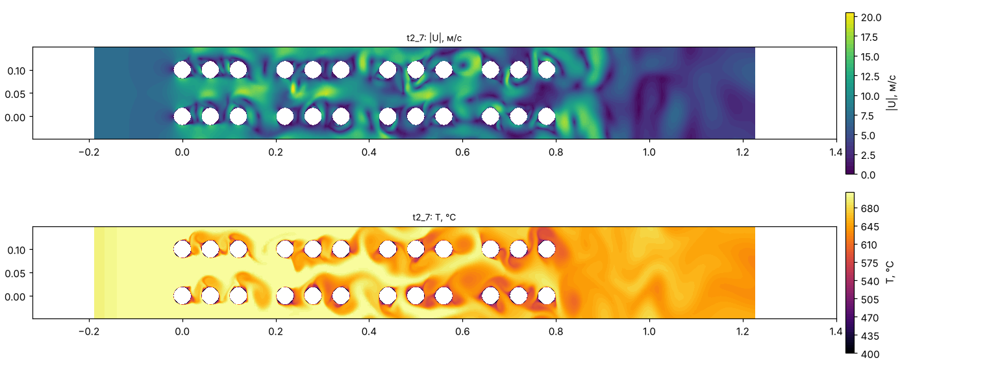

# Калибровка пористой модели пучка (кусок пароперегревателя)

Кусок: 12 труб 38 мм вдоль хода газа (4 группы по 3, шаги 60/100 мм), один поперечный шаг 100 мм,
сверху/снизу — симметрия (бесконечная решётка). Газ 700 °C, стенки труб 400 °C, 2D.
Скрипты: `model/make_cell_case.py` (кейс), `model/cell_result.py` (итоги), `model/plot_cell.py` (картинки).

## Эталоны

| U₀ перед пучком, м/с | 3 | 7 | 12 |
|---|---|---|---|
| Δp, Па — Гаддис–Гнилинский (VDI), шаг вдоль 60…100 мм | 8–11 | 47–63 | 135–180 |
| Δp — CFD с трубами, стационарный (kOmegaSST, y+<1) | 3.1 | 15.9 (качается) | развалился |
| Δp — CFD с трубами, **нестационарный**, среднее 0.10–0.25 с | — | **32.3** (пульсации ±150) | — |
| α, Вт/(м²·К) — Жукаускас / VDI | 50 / 51 | 85 / 84 | 119 / 116 |
| α — CFD стационарный | 24 | 40 | — |
| α — CFD **нестационарный** (по окнам 0.05 с: 64.6 / 57.6 / 53.1) | — | **58.4** | — |

Стационарный расчёт с трубами не годится: газ идёт «коридорами» между колоннами труб, за трубами стоит
(верхние картинки). В нестационарном коридоры раскачиваются и перемешиваются — тепло и сопротивление растут,
но до корреляций не доходят. 2D-расчёт обычно преувеличивает правильность вихрей; корреляции — это эксперименты
на пучках, но не именно с вашей группировкой труб. Истина, скорее всего, между ними.

## Два сценария пористой модели (`make_case.py --scenario A|B`)

| | Эйлер на ряд (SH / испаритель) | множитель α | пористый, U₀ = 7: Δp / α |
|---|---|---|---|
| **A** — по корреляциям | 0.159 / 0.18 | 1.0 | 44.4 Па / 82.2 |
| **B** — по CFD куска (по умолчанию) | 0.114 / 0.13 | 0.71 | 32.2 Па / 58.9 (эталон 32.3 / 58.4) |

Пористый блок B проверен на том же куске: совпадает с нестационарным CFD в пределах 1 %.
Зависимость от скорости в пористой модели — по корреляциям (Δp ~ U², α ~ U^0.63);
нестационарный CFD сделан только при 7 м/с.

## Что ещё учтено в модели котла

- Пароперегреватели: последовательно сопротивление пара ~600 Вт/(м²·К) (50 т/ч на 138 труб ∅30 внутр. — оценка).
- Испаритель: кипение, сопротивление воды не учитывается.
- Ta пучков: средняя температура пара по ступеням (противоток 250 → 440 °C), позже увязать с теплом пучков.
- Не учтены: излучение газа и пыли, загрязнение труб. Их и выбор A/B окончательно подбирать по температурам
  установки (пар 440 °C при 50 т/ч).

Сверху вниз: стационарный CFD (|U|, T), нестационарный CFD в момент 0.25 с (|U|, T), пористый B (|U|, T).

## Вторая попытка: 2 колонны, периодические границы, нестационарно (7 м/с, 0–0.45 с)

Состав газа пользователя, наклон потока на входе ~1° для слома симметрии.

| окно, с | α, Вт/(м²·К) | Δp по силе на трубах, Па | Δp по давлению на входе, Па |
|---|---|---|---|
| 0.15–0.30 | 56 | — | 16 |
| 0.30–0.375 | 42 | 86 | ~300 |
| 0.375–0.45 | 34 | 67 | ~−60 |

- Течение сильно нестационарное (вихри срываются с каждой трубы, см. картинку), с медленными колебаниями:
  среднее по окнам 0.075–0.15 с гуляет в 1.5 раза. По давлению на входе среднее вообще неинформативно —
  в канале стоячая акустическая волна ±1.7 кПа. Сила на трубах надёжнее: Δp ≈ 70–90 Па (корреляция Гаддиса ~50).
- Для надёжного среднего нужны секунды модельного времени — часы-сутки счёта на кусок. Вывод: 2D CFD куска
  пучка даёт α в диапазоне 0.4–0.7 от корреляций и Δp 0.6–1.8 от корреляций, т. е. неопределённость
  самого «эталона» больше, чем различие сценариев.
- Решение: базой «губки» брать корреляции (сценарий A: Гаддис, Жукаускас/VDI) + излучение + сопротивление пара,
  а один общий множитель к α (загрязнение + неопределённость) подбирать по установке:
  газ на выходе ~600 °C и пар 440 °C при 50 т/ч.

## Третья попытка: тот же кусок, продолжение до 0.6 с (затем расчёт развалился)

| окно, с | газ на выходе куска | α, Вт/(м²·К) | Δp по силе на трубах, Па |
|---|---|---|---|
| 0.15–0.25 | 635 °C | 61 | — |
| 0.25–0.35 | 647 °C | 48 | 84 |
| 0.35–0.45 | 660 °C | 35 | 77 |
| 0.45–0.55 | 668 °C | 28 | 149 |

α не выходит на постоянное значение, а монотонно падает, Δp растёт; около 0.602 с шаг по времени
схлопнулся и расчёт упал (повторяется при перезапуске с 0.6 с). Это дрейф/неустойчивость численной
постановки (сжимаемый 2D URANS с акустикой в замкнутом периодическом канале), а не физика пучка.
**Вывод: этот путь калибровки закрыт.** Губка остаётся на корреляциях (Гаддис — сопротивление,
Жукаускас/VDI — конвекция) + излучение газа и пыли + сопротивление пара + налёт как слой;
проверка — по установке (≈700 °C перед испарителем, 440 °C пар, ≈600 °C на выходе).
